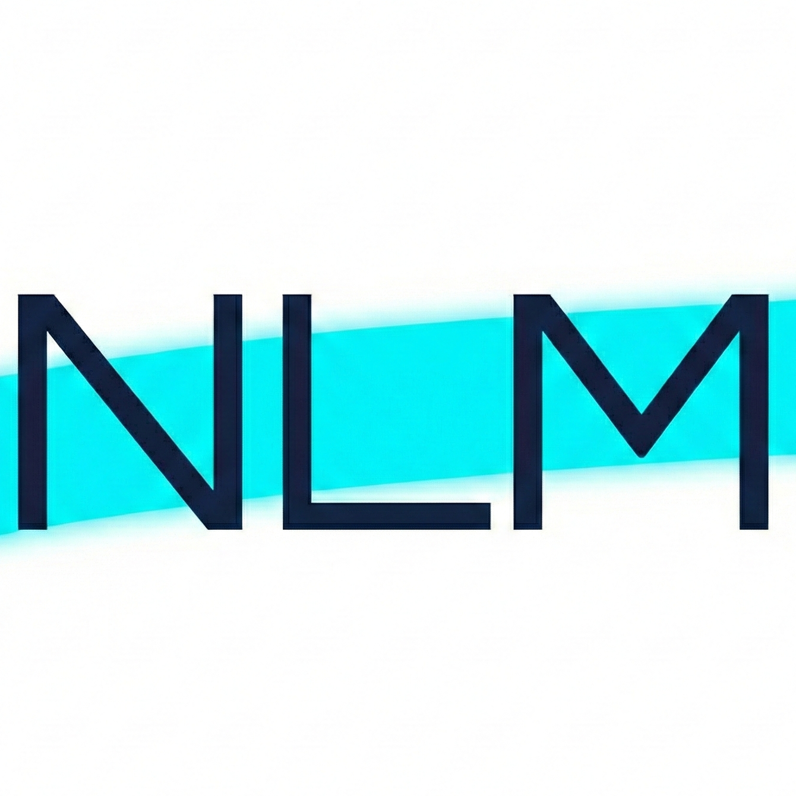
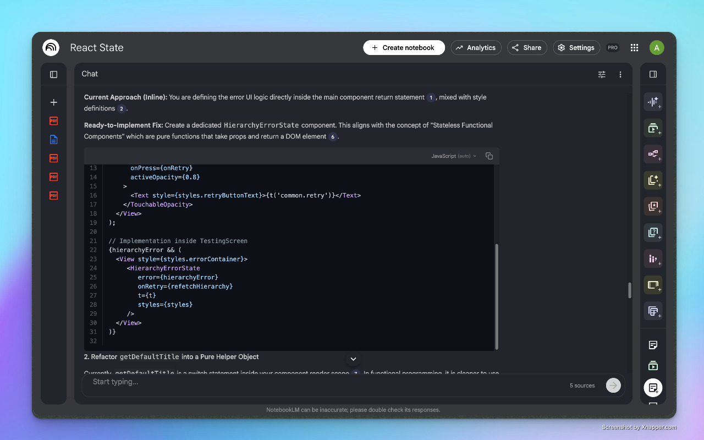
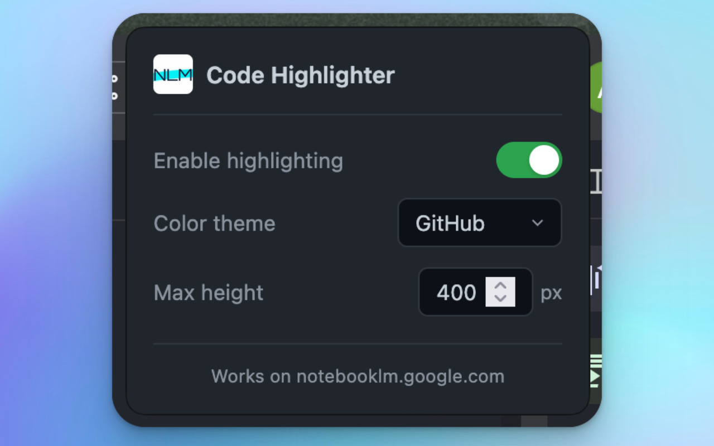

<p align="center">
  
</p>

<p align="center">
  <b>Code in NotebookLM, finally readable.</b><br>
  A Chrome and Firefox extension that adds syntax highlighting, line numbers and a copy button to every code block in NotebookLM.
</p>

<p align="center">
  <a href="https://chromewebstore.google.com/detail/notebooklm-code-highlight/mdkokjenkkpfibpbpcagcfabeonbdbng"></a>
  <a href="https://chromewebstore.google.com/detail/notebooklm-code-highlight/mdkokjenkkpfibpbpcagcfabeonbdbng"></a>
  <a href="https://addons.mozilla.org/firefox/addon/notebooklm-code-highlighter/"></a>
  
  
  
  
</p>

<p align="center">
  <a href="#install">Install</a> ·
  <a href="#what-it-does">What it does</a> ·
  <a href="#how-it-works">How it works</a> ·
  <a href="#build-from-source">Build</a> ·
  <a href="#privacy">Privacy</a> ·
  <a href="#why-not-a-generic-highlighter-extension">Why not…?</a> ·
  <a href="#faq">FAQ</a>
</p>

<p align="center">
  
  <br><sub>A NotebookLM answer with the highlighter on: colours, line numbers, auto-detected language, copy button.</sub>
</p>

NotebookLM shows code as plain grey text. This extension highlights it in place,
using a theme that follows your system's light or dark mode.

## Install

- **Chrome, Edge, Brave, Arc**: [add it from the Chrome Web Store](https://chromewebstore.google.com/detail/notebooklm-code-highlight/mdkokjenkkpfibpbpcagcfabeonbdbng).
- **Firefox**: [add it from Firefox Add-ons](https://addons.mozilla.org/firefox/addon/notebooklm-code-highlighter/).

Or [build it from source](#build-from-source).

## What it does

- **Highlights code blocks.** Every `pre > code` block in a NotebookLM answer gets syntax colours from
  [highlight.js](https://highlightjs.org/).
- **Highlights inline code too.** `inline` snippets in a sentence get colours only, with no box or buttons.
- **Detects the language.** It picks the language for you and marks the guess with *(auto)*.
- **Lets you correct it.** Pick a language from the menu on the block (searchable, with your recent picks
  first). The extension remembers it for that exact code next time.
- **Copies in one click.** The copy button copies only the code. Line numbers can't be selected, so
  they never end up in your clipboard.
- **Matches your system.** GitHub, VS Code or Atom One themes, each with a light and dark variant
  that switches with `prefers-color-scheme`.
- **Keeps long code short.** Blocks scroll past a max height you set (100–1000 px, default 400).
- **Turns off in one click.** The toolbar popup has an on/off switch, the theme and the max height.
  Changes apply to the open tab straight away.

<p align="center">
  
</p>

## How it works

1. **Watch**: a content script on `notebooklm.google.com` uses a `MutationObserver` to find new code
   blocks and inline code.
2. **Render**: each block is replaced by a React component inside a Shadow DOM, so its styles can't
   clash with NotebookLM's and NotebookLM's can't break it.
3. **Skip repeat work**: a `WeakMap` tracks rendered blocks with a SHA-256 hash of their contents.
   Identical code isn't re-rendered, and removed blocks are garbage-collected.
4. **Remember**: settings and your language picks (keyed by the code's hash, last 100 kept) live in
   `browser.storage.local`.

Details in [docs/content-script-internals.md](notebooklm-code-highlighter/docs/content-script-internals.md).

### Supported languages

JavaScript, TypeScript, Python, Java, C++, C, C#, Go, Rust, Ruby, PHP, Swift, Kotlin, SQL, Bash,
Shell, JSON, XML, HTML, CSS, SCSS, Markdown, YAML, Dockerfile, GraphQL and plain text.

## Build from source

Requires Node.js and [pnpm](https://pnpm.io/). All commands run from `notebooklm-code-highlighter/`.

```sh
cd notebooklm-code-highlighter
pnpm install

pnpm dev               # Chrome, with hot reload
pnpm dev:firefox       # Firefox, with hot reload

pnpm build             # production build in .output/
pnpm build:firefox
pnpm zip               # store-ready zip
pnpm zip:firefox

pnpm typecheck
```

To load a production build by hand:

- **Chrome**: open `chrome://extensions`, turn on Developer mode, click **Load unpacked** and pick
  `.output/chrome-mv3`.
- **Firefox**: open `about:debugging#/runtime/this-firefox`, click **Load Temporary Add-on** and pick
  any file in `.output/firefox-mv2`.

Development builds also run on `localhost`. `pnpm test:serve` serves `test/index.html`, a page of sample
code blocks, on port 3000.

## Privacy

- **No network requests, no analytics, no account.** Highlighting runs entirely in your browser.
- **One permission: `storage`**, for your settings and language picks.
- **One site.** Production builds only run on `https://notebooklm.google.com/*`.
- **Your code isn't stored.** The language cache keeps a 16-character hash of each block, never the code.

## Why not a generic highlighter extension?

- **General-purpose highlighters** run on every site and need broad permissions. This one runs on
  one site and asks only for `storage`.
- **Highlighting in place** with injected CSS clashes with NotebookLM's own styles and breaks when its
  markup changes. Shadow DOM keeps the two apart.
- **Your language picks stick.** Correct a guess once and the same code keeps that language,
  even after a reload.

## FAQ

**Does it change my notebooks or sources?**
No. It only changes how code looks on the page. Turn it off in the popup and the original blocks come back.

**The language guess is wrong. What do I do?**
Click the language label on the block and choose the right one. It's remembered for that code.

**Why isn't my language highlighted?**
Only the languages above are bundled, which keeps the extension small. Open an issue to ask for another.

**Does it work in Edge, Brave or Arc?**
They install from the Chrome Web Store, so it should. Only Chrome and Firefox are tested.

## Project layout

```text
notebooklm-code-highlighter/
  src/entrypoints/content.tsx   Finds code blocks, mounts Shadow DOM roots, watches settings
  src/entrypoints/popup/        Toolbar popup: on/off, theme, max height
  src/components/               CodeBlock, CopyButton, LanguagePicker, ErrorBoundary
  src/styles/themes.ts          GitHub, VS Code and Atom One themes (light + dark)
  src/utils/                    highlight.js setup, storage, theme detection
  test/index.html               Local page of sample code
  docs/                         Content script internals
  wxt.config.ts                 Manifest and permissions
```

## Roadmap

- [x] Syntax highlighting, line numbers, copy button
- [x] Language auto-detect with remembered overrides
- [x] Light and dark themes that follow the system
- [x] Inline code highlighting
- [ ] No flicker while answers stream in (debounce + height matching)
- [x] Chrome Web Store and Firefox Add-ons listings

## License

MIT. NotebookLM is a product of Google; this extension is not affiliated with Google.
